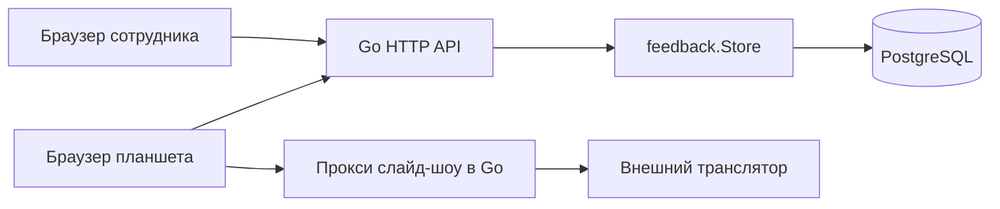
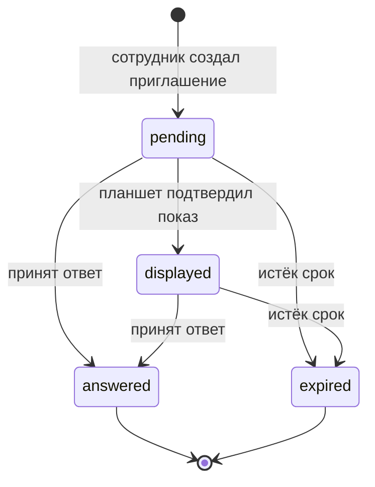

# Архитектура

RatingDon — одно Go-приложение с HTTP API, встроенным интерфейсом и PostgreSQL.
Существующий транслятор слайдов работает отдельно и подключается по HTTP.

## Пакеты

| Путь | Ответственность |
| --- | --- |
| `cmd/feedback` | Запуск, соединение компонентов, сигналы завершения |
| `internal/config` | Чтение и проверка окружения |
| `internal/httpapi` | Маршруты, авторизация, JSON, HTTP-ошибки |
| `internal/httpapi/web` | Экраны сотрудника и планшета, встроенные через `go:embed` |
| `internal/feedback` | Модели, проверки, жизненный цикл и операции хранилища |
| `internal/postgres` | Создание и проверка пула pgx |
| `internal/slideshow` | Прокси разрешённых ресурсов внешнего плеера |
| `migrations` | Версионируемые изменения схемы PostgreSQL |

Обработчик зависит от интерфейса `RatingScore`, объявленного в `httpapi`.
`feedback.Store` реализует его для PostgreSQL; HTTP-тесты подставляют заглушку.
SQL и транзакции сосредоточены в хранилище, преобразование ошибок в HTTP —
в обработчиках. Отдельного сервисного слоя в текущей реализации нет.

## Приглашение и ответ

`rating_requests` хранит UUID приглашения, устройство, состояние и временные
отметки. `ratings` хранит идентификатор приглашения и оценку 1–5.
Таблицы соединяются по `ratings.request_id = rating_requests.id`.
Существующие исторические оценки без приглашений сохраняются.

Подтверждение показа не является обязательным условием принятия ответа:
действующее приглашение в `pending` тоже допускает ответ.
Истечение срока фиксируется при обращениях к хранилищу, отдельной фоновой
задачи очистки нет. Клиент закрывает форму по серверному сроку даже при потере связи.

## Конкурентный доступ

Создание приглашения использует транзакционную advisory-блокировку по устройству
и частичный уникальный индекс: одновременно активно только одно приглашение.
Ответ блокирует строку приглашения через `FOR UPDATE`; запись оценки и переход
в `answered` выполняются одной транзакцией.

Повтор того же ответа возвращает сохранённый результат, включая повтор после
первоначального срока. Попытка заменить принятую оценку возвращает конфликт.
Идентификатор чужого планшета не раскрывает его приглашение.

## Связь и слайд-шоу

Планшет опрашивает API примерно раз в секунду после завершения предыдущего
запроса. Устройство считается подключённым, если последнее обращение к его
маршруту состояния было менее восьми секунд назад.
Эти отметки защищены mutex и хранятся только в памяти процесса.
После перезапуска планшеты восстанавливают их следующим опросом.

Прокси `/slideshow/` допускает только чтение поддерживаемых ресурсов плеера,
не пересылает ключи и cookies приложения. Это адаптер существующего транслятора,
а не универсальное встраивание любого сайта. Во время формы интерфейс
приостанавливает плеер; затем продолжает показ в том же iframe.

## Границы текущего решения

Одного процесса достаточно для пилота. Горизонтальное масштабирование потребует
общего механизма присутствия устройств. Имена устройств и ключи задаются при
запуске; интерфейса регистрации устройств и пользовательских учётных записей нет.
