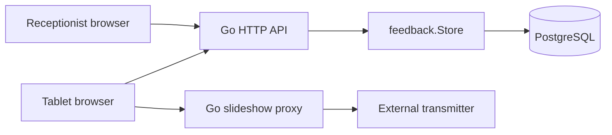
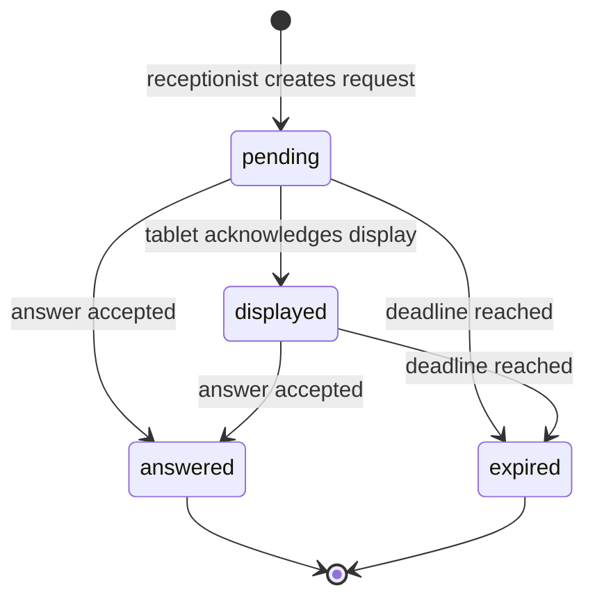

# Architecture

RatingDon is a single Go application with an HTTP API, an embedded frontend,
and PostgreSQL storage. The existing slideshow transmitter runs separately
and is accessed over HTTP.

## Packages

| Path | Responsibility |
| --- | --- |
| `cmd/feedback` | Startup, component wiring, shutdown signals |
| `internal/config` | Environment parsing and validation |
| `internal/httpapi` | Routing, authorization, JSON, HTTP errors |
| `internal/httpapi/web` | Receptionist and tablet screens, embedded with `go:embed` |
| `internal/feedback` | Models, validation, request lifecycle, storage operations |
| `internal/postgres` | pgx connection pool creation and connectivity checks |
| `internal/slideshow` | Proxy for permitted external player resources |
| `migrations` | Versioned PostgreSQL schema changes |

HTTP handlers depend on the `RatingScore` interface declared in `httpapi`.
`feedback.Store` implements it for PostgreSQL; HTTP tests use a stub.
SQL and transactions live in the store. Handlers translate application errors
into HTTP responses. There is no separate service layer in this implementation.

## Requests and answers

`rating_requests` stores the request UUID, device, status, and timestamps.
`ratings` stores a request ID and a score from 1 to 5. The tables are joined on
`ratings.request_id = rating_requests.id`. Existing legacy ratings without
corresponding requests are preserved.

Display acknowledgement is not required to submit an answer:
a valid request in `pending` can also be answered. Expiration is persisted
when the store is accessed; there is no background cleanup job.
The client closes the form at the server-provided deadline even if connectivity
is lost.

## Concurrent access

Request creation uses a per-device transaction advisory lock and a partial
unique index to enforce one active request per device. Answer submission locks
the request row with `FOR UPDATE`; inserting the rating and changing the status
to `answered` happen in one transaction.

Retrying the same answer returns the stored result, even after the original
deadline. Attempting to change an accepted score returns a conflict.
Requests belonging to another tablet are treated as not found.

## Connectivity and slideshow

The tablet polls the API approximately one second after each completed request.
A device is online if its state endpoint was accessed less than eight seconds
ago. These timestamps are protected by a mutex and kept in process memory.
After a restart, subsequent tablet polls restore presence.

The `/slideshow/` proxy permits read-only access to supported player resources
and does not forward application tokens or cookies. It adapts the existing
transmitter rather than embedding arbitrary websites. The interface pauses
the player while the form is visible and resumes it in the same iframe.

## Deployment boundaries

The pilot uses one application process. Horizontal scaling would require
shared device presence tracking. Devices can be configured at startup or enrolled through the administrator API.
Enrolled device names and token digests are stored in `device_registry`.
Configured IDs take precedence if they overlap an enrolled ID.
There is no user account system.
