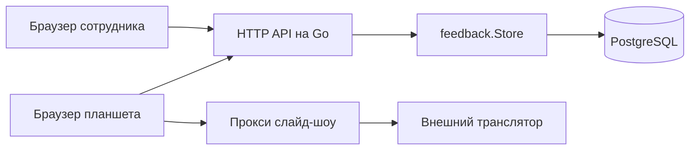
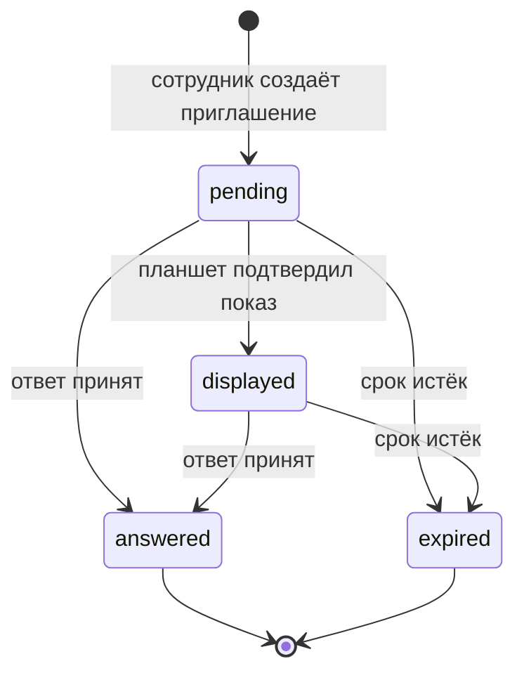

# Архитектура

[English](architecture.en.md)

RatingDon — приложение на Go с HTTP API, встроенным веб-интерфейсом и хранилищем PostgreSQL. Транслятор слайдов работает отдельно. Приложение обращается к нему по HTTP.

## Пакеты

| Путь | Назначение |
| --- | --- |
| `cmd/feedback` | Запуск, создание компонентов и обработка сигналов остановки |
| `internal/config` | Разбор и проверка переменных окружения |
| `internal/httpapi` | Маршруты, авторизация, JSON и HTTP-ошибки |
| `internal/httpapi/web` | Экраны сотрудника и планшета, встроенные через `go:embed` |
| `internal/feedback` | Модели, валидация, состояния приглашения и операции с БД |
| `internal/postgres` | Пул подключений pgx и проверка связи с БД |
| `internal/slideshow` | Прокси для разрешённых ресурсов внешнего плеера |
| `migrations` | Версии схемы PostgreSQL |

HTTP-обработчики используют интерфейс `RatingScore` из `httpapi`. Для PostgreSQL его реализует `feedback.Store`, в HTTP-тестах используется заглушка. SQL и транзакции находятся в хранилище. Обработчики преобразуют ошибки приложения в HTTP-ответы.

## Приглашения и оценки

В `rating_requests` хранятся UUID приглашения, устройство, статус и время событий. В `ratings` хранятся ID приглашения и оценка от 1 до 5. Таблицы связывает условие `ratings.request_id = rating_requests.id`. Старые оценки без соответствующих приглашений сохраняются.

Действительное приглашение в статусе `pending` можно оценить до подтверждения показа. Истечение срока записывается при обращении к хранилищу. Форма на планшете закрывается в срок, заданный сервером, даже при потере связи.

## Параллельные запросы

Транзакционная advisory-блокировка на устройство и частичный уникальный индекс гарантируют, что на планшете будет не больше одного активного приглашения. При ответе строка приглашения блокируется через `FOR UPDATE`. Запись оценки и смена статуса на `answered` происходят в одной транзакции.

Повтор той же оценки возвращает сохранённый результат даже после истечения срока. Попытка поставить другую оценку возвращает конфликт. Приглашение другого планшета считается ненайденным.

## Связь с планшетом и слайд-шоу

Планшет опрашивает API примерно через секунду после предыдущего ответа. Устройство считается подключённым, если его маршрут состояния вызывался менее восьми секунд назад. Время последнего обращения хранится в памяти процесса и защищено мьютексом. После перезапуска список подключённых устройств восстанавливается по следующим запросам планшетов.

Прокси `/slideshow/` выдаёт разрешённые ресурсы внешнего плеера в режиме чтения. Ключи и cookies RatingDon транслятору не передаются. Пока форма видна, плеер стоит на паузе. После закрытия формы показ продолжается в том же iframe.

## Ограничения развёртывания

Приложение работает одним процессом. Для нескольких экземпляров понадобится общее хранилище статуса подключения устройств. Планшеты задаются при запуске или регистрируются через API сотрудника. Имена зарегистрированных устройств и хеши ключей сохраняются в `device_registry`. Если ID совпадают, приоритет у устройства из конфигурации. Сотрудники используют общий ключ доступа.
